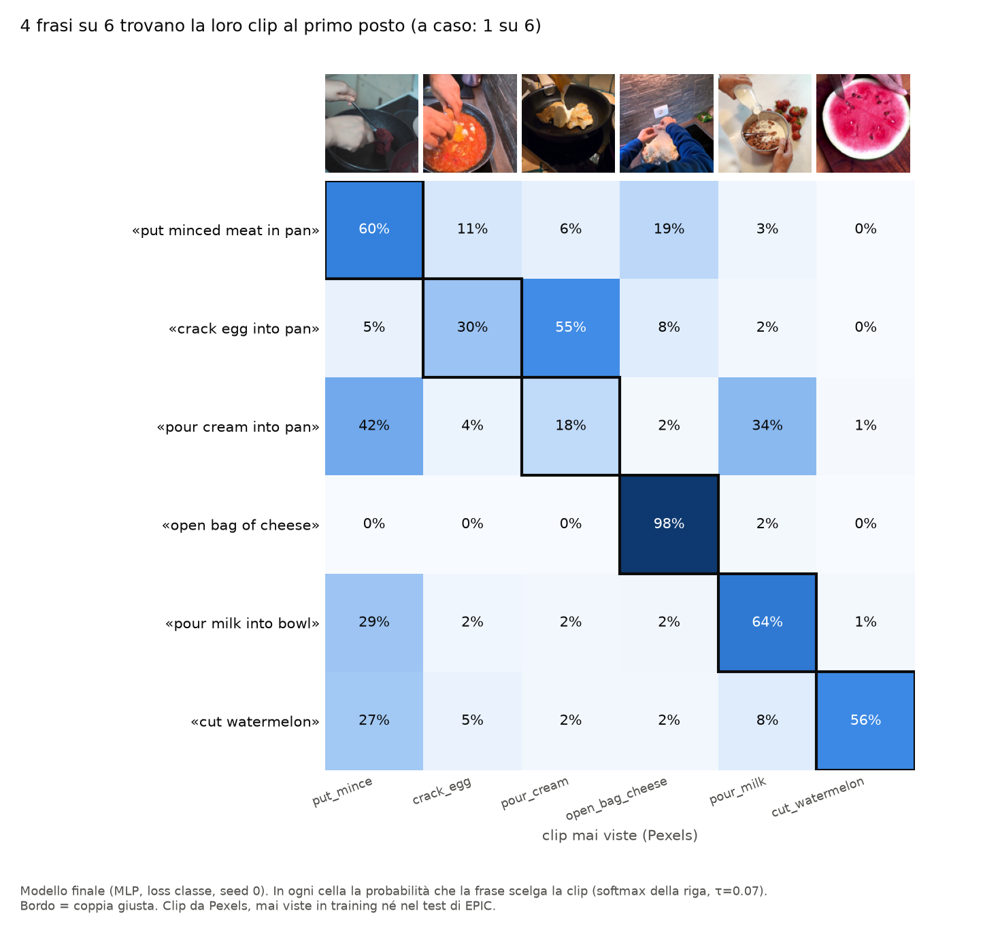

# Demo con clip esterne



**Cosa mostra.** 6 clip di Pexels mai viste dal modello, né in training né nel test di EPIC, e
una frase per clip. Per ogni frase (riga), quanto il modello finale (MLP `classe`, seed 0) la
associa a ciascuna clip (colonna). Il bordo indica la coppia giusta.
Script: `src/evaluation/demo_clip_esterne.py`.

**La formula.** Per ogni frase il modello calcola il coseno con le 6 clip; la softmax della riga
lo trasforma in probabilità:

```
p(clip j | frase) = exp(cos_j / τ) / Σ_k exp(cos_k / τ)        τ = 0.07
```

τ è la temperatura con cui il modello è stato allenato (InfoNCE usa la stessa softmax). Dividere
per 0.07 fa pesare differenze piccole tra coseni. Ogni riga somma a 100%.

**Esempio** («slice watermelon»): coseni 0.122 (cut_watermelon) e 0.108 (put_mince) diventano
exp(1.74) = 5.71 e exp(1.54) = 4.68; con le altre 4 clip la somma è 12.61, quindi
5.71 / 12.61 = **45%** e 4.68 / 12.61 = **37%**.

