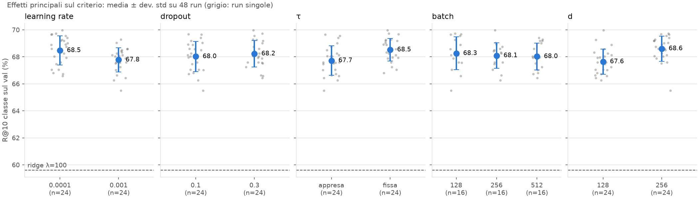

# Ripasso: P4 · Effetti principali della griglia

Scritto per: te, per ripassare.

## Cosa mostra
Per ogni iperparametro della griglia (lr, dropout, τ, batch, d), la R@10 per classe sul val, su tutte le 48 run.
- **Punti grigi**: le singole run (seed 0).
- **Punto blu**: la media di quel valore.
- **Barra blu**: ±1 deviazione standard **tra run**. Non è l'errore standard.
- **Linea tratteggiata**: il ridge di riferimento (λ=100), circa 59.6.

## Numeri chiave
| Leva | Valori (media) | Differenza |
|---|---|---|
| lr | 1e-4: 68.5 · 1e-3: 67.8 | 0.7 |
| dropout | 0.1: 68.0 · 0.3: 68.2 | 0.2 |
| τ | appresa: 67.7 · fissa: 68.5 | 0.8 |
| batch | 128: 68.3 · 256: 68.1 · 512: 68.0 | 0.3 |
| d | 128: 67.6 · 256: 68.6 | 1.0 |

## Come leggerlo
1. **Guarda il ridge prima di tutto.** Tutte le run stanno circa 8 punti sopra. È il risultato più solido.
2. **Confronta la distanza tra i punti medi con la larghezza delle barre.** Se le barre si sovrappongono molto, la differenza può essere rumore.
3. **Attenzione alle medie per leva.** Ogni media è calcolata su tutte le altre leve. Un effetto può dipendere da un'altra leva: per questo ci sono le heatmap.

## Trappole
- Il grafico non mostra la metrica "nuove classi", dove d=256 è molto più alto (24.7 contro 20.1).
- Le 48 run sono tutte sul subset di 4 partecipanti.
- Il seed 0 è ottimistico: le differenze reali sono più piccole di quelle viste qui (vedi il grafico dei seed).
