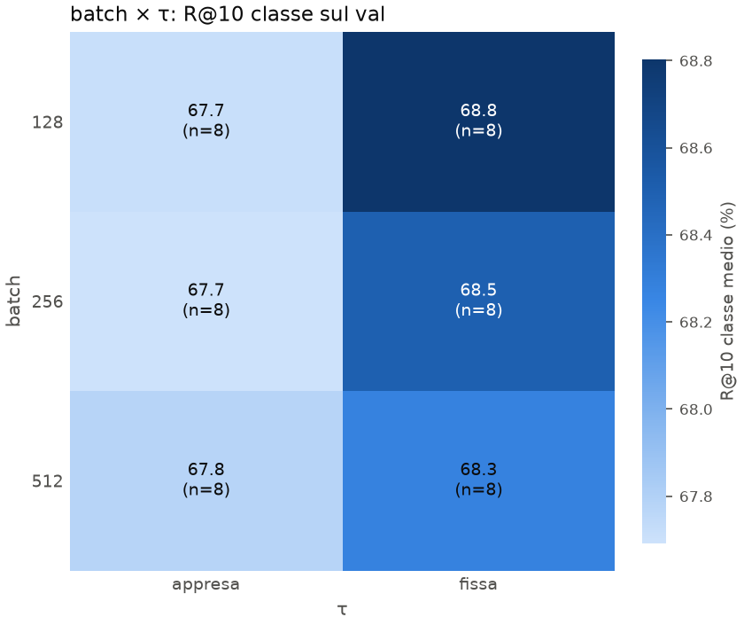

# Ripasso: P4 · Heatmap batch × τ

Scritto per: te, per ripassare.

## Cosa mostra
La media della R@10 per classe sul val, per ogni coppia di valori di batch (righe) e τ (colonne). Ogni cella è la media di 8 run.
- **Righe**: batch 128, 256, 512.
- **Colonne**: τ appresa, τ fissa a 0.07.
- **Colore**: più scuro = valore più alto. Il colorbar va da 67.8 a 68.8.

## Numeri chiave
| batch | τ appresa | τ fissa |
|---|---|---|
| 128 | 67.7 | **68.8** |
| 256 | 67.7 | 68.5 |
| 512 | 67.8 | 68.3 |

## Come leggerlo
1. **Leggi per colonna.** Con τ appresa il batch non cambia nulla (67.7–67.8). Con τ fissa il batch conta un po': il valore più alto è a batch 128.
2. **Leggi per riga.** Con ogni batch, τ fissa batte τ appresa di 0.5–1.1 punti.
3. **Interazione.** L'effetto di τ dipende dal batch: a batch piccoli la τ fissa rende di più. Per questo non basta guardare gli effetti principali.

## Trappole
- **Il colore esagera le differenze.** Il colorbar si adatta ai dati, quindi una differenza di 1 punto sembra molto grande. Leggi i numeri nelle celle.
- **Ogni cella è una media di 8 run con deviazione standard di circa 1.** L'errore sulla media è circa 0.3. Le differenze tra celle di circa 0.2–0.3 sono rumore.
- Le run sono solo seed 0 e sul subset di 4 partecipanti.
