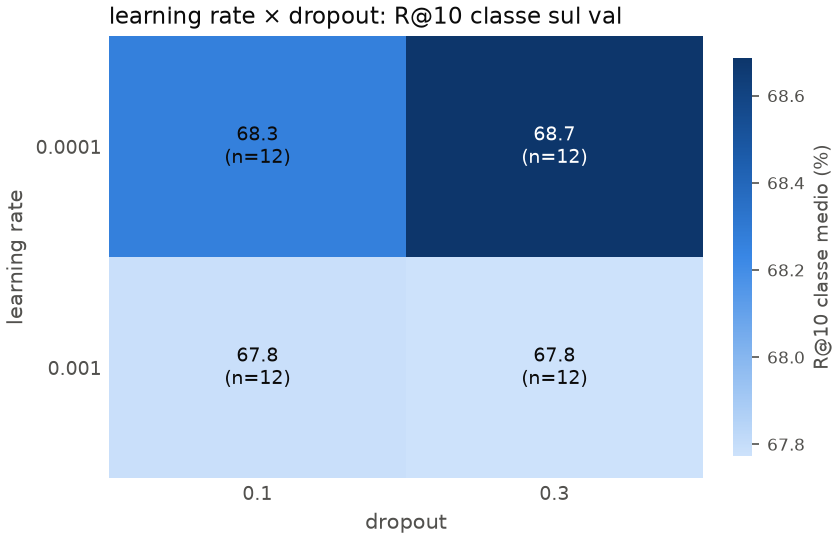

# Ripasso: P4 · Heatmap learning rate × dropout

Scritto per: te, per ripassare.

## Cosa mostra
La media della R@10 per classe sul val, per ogni coppia di valori di learning rate (righe) e dropout (colonne). Ogni cella è la media di 12 run.
- **Righe**: lr 1e-4, 1e-3.
- **Colonne**: dropout 0.1, 0.3.
- **Colore**: più scuro = valore più alto. Il colorbar va da 67.8 a 68.7.

## Numeri chiave
| lr | dropout 0.1 | dropout 0.3 |
|---|---|---|
| 1e-4 | 68.3 | **68.7** |
| 1e-3 | 67.8 | 67.8 |

## Come leggerlo
1. **Leggi per riga.** Con lr 1e-3 il dropout non cambia nulla (67.8 in entrambe le celle). Con lr 1e-4 il dropout 0.3 batte 0.1 di 0.4 punti.
2. **Leggi per colonna.** Con dropout 0.1 o 0.3, lr 1e-4 è sempre sopra lr 1e-3, di 0.5–0.9 punti.
3. **Interazione.** Il dropout conta solo con il learning rate basso. Non è un effetto isolato, quindi gli effetti principali da soli lo nasconderebbero.

## Trappole
- **Il colore esagera le differenze.** Il colorbar va da 67.8 a 68.7, quindi una differenza di 0.4 sembra grande. Leggi i numeri.
- **Ogni cella è una media di 12 run.** Con deviazione standard di circa 1, l'errore sulla media è circa 0.3. Il +0.4 del dropout è al limite del rumore: non è una prova forte.
- Le run sono solo seed 0 e sul subset di 4 partecipanti.
