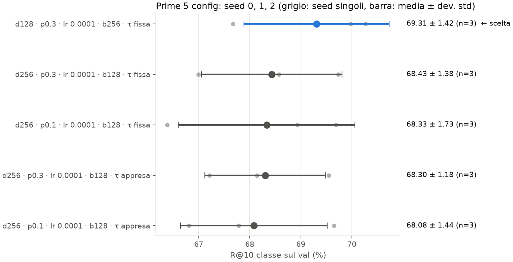

# Ripasso: P4 · Seed sulle prime 5 config

Scritto per: te, per ripassare.

## Cosa mostra
Le 5 config migliori della fase 1, rilanciate con tre seed (0, 1, 2). Per ogni riga:
- **Punti grigi**: il valore di R@10 per classe sul val per ogni seed.
- **Punto e barra**: la media e ±1 deviazione standard. In blu la config scelta, in grigio le altre.
- **Testo a destra**: media ± deviazione standard e numero di seed finiti.

## Numeri chiave
| Config (d · p · lr · batch · τ) | seed 0 | seed 1 | seed 2 | media ± std |
|---|---|---|---|---|
| d128 · 0.3 · 1e-4 · 256 · fissa | 69.98 | 67.67 | 70.27 | **69.31 ± 1.42** |
| d256 · 0.3 · 1e-4 · 128 · fissa | 69.73 | 66.99 | 68.57 | 68.43 ± 1.38 |
| d256 · 0.1 · 1e-4 · 128 · fissa | 69.69 | 66.38 | 68.93 | 68.33 ± 1.73 |
| d256 · 0.3 · 1e-4 · 128 · appresa | 69.55 | 67.21 | 68.14 | 68.30 ± 1.18 |
| d256 · 0.1 · 1e-4 · 128 · appresa | 69.65 | 66.81 | 67.78 | 68.08 ± 1.44 |

## Come leggerlo
1. **Guarda i punti grigi, non solo la media.** Le barre si sovrappongono quasi tutte. Le differenze tra config sono piccole rispetto alla dispersione tra seed.
2. **Guarda il seed 0.** È il più alto per tutte le config (69.5–70.0), quindi è ottimistico. Sui seed 1 e 2 le config scendono di 1–3 punti.
3. **Guarda il seed 1.** È il più basso per tutte le config (66.4–67.7). Forse il seed influenza il risultato in modo sistematico.
4. **La scelta.** La regola della roadmap dice: due config sono alla pari se la differenza è minore della deviazione standard maggiore. Qui la differenza massima è 1.23 e la deviazione massima è 1.44: **tutte e 5 sono alla pari.** La scelta di d=128 è quindi un tie-break per semplicità, non una differenza misurata.

## Trappole
- **Il winner's curse.** La config migliore della griglia è migliore anche per fortuna del seed 0. Il valore vero è più basso.
- **La media d128 è sostenuta dal seed 2.** Senza il seed 2 sarebbe sotto le altre config.
- **Le epoche migliori variano molto.** Per la config scelta vanno da 34 a 61. Non è incluso nel grafico, ma è nel file `p4_seed.csv`.
- Il grafico non mostra la metrica "nuove classi", che favorisce d=256.
- Le run sono sul subset di 4 partecipanti.
