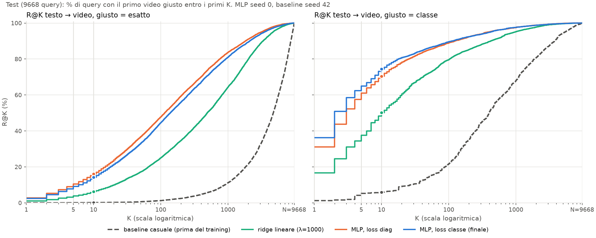
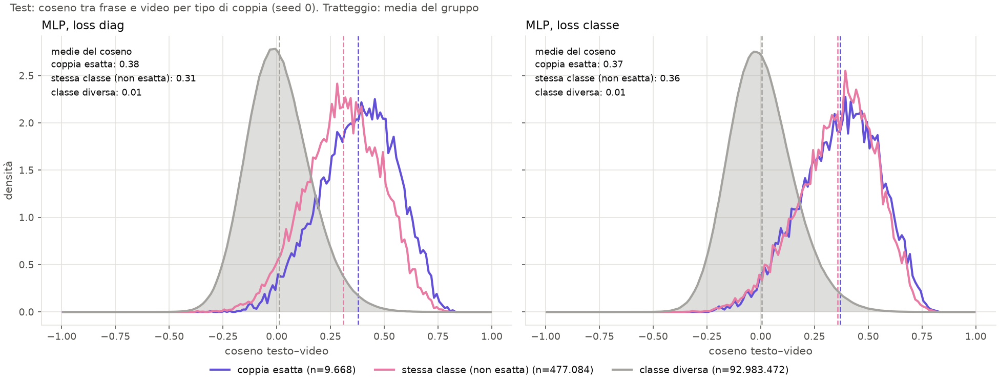

# Figure di P6 spiegate

Due figure sul **test** (9668 clip), modelli con seed 0 (baseline seed 42), fissati prima di
disegnarle. Generate da `src/evaluation/p6_figures.py`.

---

## 1. Curva R@K al variare di K: `p6_recall_k.png`

**Cosa c'e' sugli assi**
- x: K, cioe' quanti video guardo in cima alla lista (scala logaritmica, da 1 a 9668).
- y: R@K, la % di frasi per cui il primo video giusto e' tra i primi K.
- A K = 1, 5, 10 la curva vale le R@1/5/10 della tabella (il punto e' la R@10).
- La curva sale sempre e a K = N arriva al 100%: guardando tutti i video, quello giusto c'e'.

**Come si legge**: piu' la curva sta **in alto a sinistra**, meglio e', perche' il video giusto
compare prima. Dove la curva incrocia il 50% si legge il **rango mediano**.

**Pannello esatto** (giusto = la clip con lo stesso `narration_id`)

| modello | R@10 | rango mediano |
|---|---|---|
| baseline | ~0.1 | ~4800, cioe' circa N/2: e' il caso |
| ridge | 6.3 | 491 |
| MLP `diag` | 16.1 | ~115 |
| MLP `classe` | 14.2 | ~140 |

- La baseline e' il caso: con proiezioni non allenate il giusto e' in un punto qualsiasi della lista.
- Il training sposta tutto a sinistra: ridge di un ordine di grandezza, MLP di un altro.
- `diag` sta sopra `classe` **su tutto l'asse**, non solo a K = 10: e' il costo della loss multi-positivo.

**Pannello classe** (giusto = qualsiasi video con stesso verbo e stesso nome)
- Le curve partono molto piu' in alto (R@1 ~36% per `classe`): ogni frase ha in media circa 49
  video giusti, quindi trovarne uno e' piu' facile.
- `classe` batte `diag` soprattutto a **K piccolo** (R@1 36 contro 31). Da K ≈ 30 in poi le due
  curve coincidono: la loss multi-positivo non trova "piu' video giusti", **li mette piu' in
  cima** alla lista.

> **Da ricordare:** le R@K della tabella sono tre punti di questa curva. La curva mostra che le
> differenze tra modelli non dipendono dalla scelta di K = 1, 5, 10.

---

## 2. Coseno per tipo di coppia: `p6_coseni.png`

**Cosa mostra**: per ogni coppia (frase, video) del test, il coseno nello spazio comune, cioe'
quanto il modello le considera simili. Le coppie sono divise in tre gruppi:

| gruppo | coppie | cosa sono |
|---|---|---|
| coppia esatta | 9.668 | la frase e il suo video |
| stessa classe (non esatta) | 477.084 | stesso verbo e nome, clip diversa (in media ~49 per frase) |
| classe diversa | ~93 milioni | tutto il resto |

Gli istogrammi sono **normalizzati** (densita'): l'area sotto ogni curva vale 1, cosi' gruppi di
dimensioni diverse si confrontano per forma e posizione.

**Medie del coseno**

| | coppia esatta | stessa classe | classe diversa |
|---|---|---|---|
| MLP `diag` | 0.38 | 0.31 | 0.01 |
| MLP `classe` | 0.37 | **0.36** | 0.01 |

**Come si legge**
- In entrambi i modelli la classe diversa sta intorno a 0 e i video giusti a destra: il modello
  separa bene le classi. Gli errori nascono nella **zona di sovrapposizione** (circa 0.1–0.3), dove
  alcune coppie di classe diversa sono simili quanto quelle giuste.
- **`diag`**: la curva rosa (stessa classe) sta **a sinistra** di quella viola (esatta), con uno
  scarto di 0.07. La loss classica tratta le altre clip della stessa classe come negativi e le
  allontana un po'.
- **`classe`**: rosa e viola **si sovrappongono** (0.36 contro 0.37). La loss multi-positivo dice
  che tutte le clip della stessa classe sono giuste allo stesso modo, e il modello le mette alla
  stessa distanza dalla frase.

**Perche' spiega il trade-off della tabella**
- Con `classe`, la clip esatta e' "mescolata" con le ~49 della stessa classe: nella ricerca
  *esatta* compete alla pari con loro, quindi esatto R@10 scende (−2.4).
- Le clip della stessa classe sono tutte vicine alla frase e lontane dalle altre classi: nella
  ricerca *per classe* ne arriva una in cima piu' spesso, quindi classe R@1/R@10 sale (+3.6 / +2.4).

> **Da ricordare:** la loss decide **cosa** il modello impara a tenere vicino. `diag` impara la
> clip; `classe` impara l'azione (verbo + nome). La figura lo mostra direttamente nello spazio
> degli embedding, non solo con una metrica.

---

## Avvertenze
- Le figure usano **un solo seed** (0). Sul test il seed 0 di `classe` e' il migliore dei tre
  (classe R@10 74.4 contro una media di 72.9): lo scarto tra `classe` e `diag` qui appare un po'
  piu' grande della media. I numeri da citare sono quelli di `experiments/final/final_test.csv`.
- "Stessa classe" include anche le **frasi identiche** (stesso testo, clip diversa). Per quelle
  nessun modello puo' distinguere la clip esatta, perche' l'embedding del testo e' lo stesso.
- I coseni assoluti sono bassi (~0.37), ma conta l'**ordine**, non il valore: il retrieval
  ordina i video per coseno, e 0.37 contro 0.01 e' una separazione netta.
