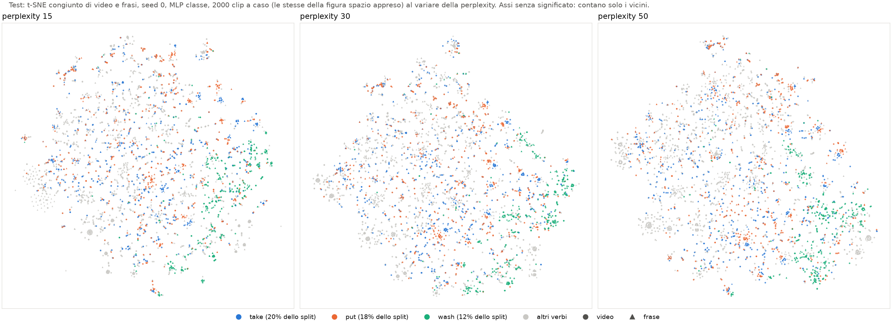

# Ripasso: P7 · t-SNE al variare della perplexity (test)

## Perché serve questa figura
t-SNE ha un parametro, la **perplexity**: quanti vicini considera ogni punto (più o meno).
- **bassa** (15): guarda pochi vicini, mette in risalto i gruppetti molto locali;
- **alta** (50): guarda più vicini, mostra regioni più ampie.

Una struttura che compare con una sola perplexity può essere un artefatto. Una struttura che
resta con tutte è reale. Questa figura è il **controllo di robustezza** delle altre due.

## Cosa mostra
- **MLP con loss `classe`, seed 0.**
- **Le stesse 2000 clip** della figura `p7_tsne_spazio_appreso_test.png`, con gli stessi colori
  e marker (cerchio = video, triangolo = frase; take, put, wash, grigio = altri verbi).
- **Tre pannelli**: perplexity 15, 30 e 50. Il pannello a 30 è lo stesso fit del pannello
  "MLP, loss classe" della prima figura.
- Niente etichette dei verbi, per non coprire i punti nei pannelli più piccoli.

## Come leggerlo
Le conclusioni della prima figura restano vere con tutte e tre le perplexity:

| Osservazione | 15 | 30 | 50 |
|---|---|---|---|
| video e frasi mescolati (niente modality gap) | sì | sì | sì |
| wash in una regione propria | sì, a destra | sì, in basso a destra | sì, in basso a destra, più compatta |
| take e put mescolati e sparsi | sì | sì | sì |
| piccoli gruppi compatti (frasi + video della stessa classe) | molti, piccoli | sì | meno, inglobati in regioni più ampie |

Cosa cambia:
1. **La grana.** A 15 la mappa è frammentata in tanti gruppetti. A 50 i gruppetti si fondono in
   regioni più grandi: la regione di wash diventa un blocco unico più netto.
2. **La posizione delle regioni** (wash a destra o in basso a destra). Non conta nulla: in t-SNE
   la posizione assoluta non ha significato.

Conclusione: **la struttura vista nella prima figura non dipende dalla perplexity scelta.**

## Trappole
- **Non si scelgono le figure "più belle".** La perplexity 30 è stata fissata prima di
  guardarle. Le altre due servono solo come controllo.
- **Stesse clip, ma fit diversi.** Un punto non sta nella stessa posizione da un pannello
  all'altro. Si confronta solo cosa resta vicino a cosa.
- **Robusto non vuol dire migliore.** Questa figura dice che la struttura è reale, non che il
  modello sia buono. Quello lo dicono R@K e rango mediano.
- Il controllo riguarda solo il modello `classe`. Per `diag` non è stato fatto.
