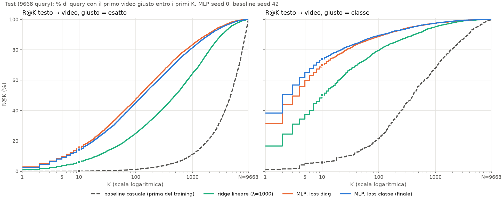

# Figure di P6 spiegate

Una figura sul **test** (9668 clip), modelli con seed 0 (baseline seed 42), fissati prima di
disegnarla. Generata da `src/evaluation/final_figures.py`.

---

## 1. Curva R@K al variare di K: `test_recall_k.png`

**Cosa c'e' sugli assi**
- x: K, cioe' quanti video guardo in cima alla lista (scala logaritmica, da 1 a 9668).
- y: R@K, la % di frasi per cui il primo video giusto e' tra i primi K.
- A K = 1, 5, 10 la curva vale le R@1/5/10 della tabella (il punto e' la R@10).
- La curva sale sempre e a K = N arriva al 100%: guardando tutti i video, quello giusto c'e'.

**Come si legge**: piu' la curva sta **in alto a sinistra**, meglio e', perche' il video giusto
compare prima. Dove la curva incrocia il 50% si legge il **rango mediano**.

**Pannello esatto** (giusto = la clip con lo stesso `narration_id`)

| modello | R@10 | rango mediano |
|---|---|---|
| baseline | ~0.1 | ~4800, cioe' circa N/2: e' il caso |
| ridge | 6.3 | 491 |
| MLP `diag` | 16.1 | ~115 |
| MLP `classe` | 14.2 | ~140 |

- La baseline e' il caso: con proiezioni non allenate il giusto e' in un punto qualsiasi della lista.
- Il training sposta tutto a sinistra: ridge di un ordine di grandezza, MLP di un altro.
- `diag` sta sopra `classe` **su tutto l'asse**, non solo a K = 10: e' il costo della loss multi-positivo.

**Pannello classe** (giusto = qualsiasi video con stesso verbo e stesso nome)
- Le curve partono molto piu' in alto (R@1 ~36% per `classe`): ogni frase ha in media circa 49
  video giusti, quindi trovarne uno e' piu' facile.
- `classe` batte `diag` soprattutto a **K piccolo** (R@1 36 contro 31). Da K ≈ 30 in poi le due
  curve coincidono: la loss multi-positivo non trova "piu' video giusti", **li mette piu' in
  cima** alla lista.

> **Da ricordare:** le R@K della tabella sono tre punti di questa curva. La curva mostra che le
> differenze tra modelli non dipendono dalla scelta di K = 1, 5, 10.

---

## Avvertenze
- La figura usa **un solo seed** (0). Sul test il seed 0 di `classe` e' il migliore dei tre
  (classe R@10 74.4 contro una media di 72.9): lo scarto tra `classe` e `diag` qui appare un po'
  piu' grande della media. I numeri da citare sono quelli di `experiments/final/final_test.csv`.
- "Stessa classe" include anche le **frasi identiche** (stesso testo, clip diversa). Per quelle
  nessun modello puo' distinguere la clip esatta, perche' l'embedding del testo e' lo stesso.
