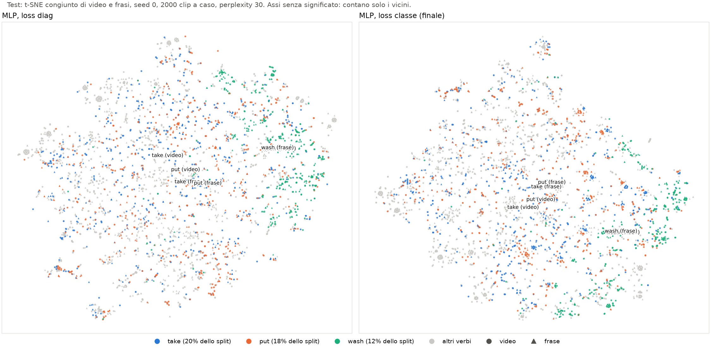

# Ripasso: P7 · t-SNE dello spazio appreso (test)

## Cos'è t-SNE, in breve
Gli embedding del modello hanno 128 dimensioni. t-SNE li porta in 2D cercando di fare in modo
che ogni punto abbia **gli stessi vicini** che aveva in 128D. Quindi:
- **si legge**: chi sta vicino a chi, se un gruppo di punti forma un blocco compatto;
- **non si legge**: la distanza tra due gruppi lontani, la grandezza di un gruppo, gli assi
  (non hanno unità né significato).

È la visualizzazione naturale per il retrieval: R@K chiede proprio se il video giusto è tra i K
vicini più prossimi della frase.

## Cosa mostra
- **2000 clip a caso del test** (seed 0), su 9668. Ogni clip dà due punti: il suo video
  (**cerchio**) e la sua frase (**triangolo**). In tutto 4000 punti per pannello.
- **Un solo t-SNE per pannello, con video e frasi insieme.** Si può fare perché dopo il training
  video e testo vivono nello stesso spazio. Metrica coseno (quella del modello), perplexity 30.
- **Due pannelli**: MLP con loss `diag` (InfoNCE classica) e MLP con loss `classe` (modello
  finale). Entrambi seed 0, come fissato in D4.
- **Colore = verbo**, solo per i 3 più frequenti: take (20% del test), put (18%), wash (12%).
  Gli altri verbi sono grigi. Più di 3 colori in uno scatter non si distinguono bene, soprattutto
  per chi è daltonico.
- **Etichette**: il nome del verbo è scritto sulla mediana dei suoi video e delle sue frasi.

## Numeri chiave (test, seed 0)
| Modello | esatto R@10 | classe R@10 |
|---|---|---|
| MLP `diag` | 15.73 | 70.21 |
| MLP `classe` | 14.37 | 73.99 |

## Come leggerlo
1. **Non c'è modality gap.** Cerchi e triangoli sono mescolati ovunque, in entrambi i pannelli.
   Le etichette "verbo (video)" e "verbo (frase)" dello stesso verbo cadono quasi nello stesso
   punto: per wash si sovrappongono del tutto. Video e frasi occupano davvero la stessa regione
   dello spazio. Non era scontato: nei modelli tipo CLIP spesso le due modalità restano in due
   regioni separate.
2. **wash ha una regione sua, take e put no.** I punti verdi si raccolgono in una zona propria
   (a destra in entrambi i pannelli). Blu e arancione invece sono sparsi su tutta la mappa e
   mescolati tra loro. Per questo le etichette di take e put cadono al centro: la mediana di
   punti sparsi ovunque finisce in mezzo. Un'ipotesi che la figura da sola non dimostra: take e
   put sono gesti mano-oggetto simili tra loro e si combinano con quasi tutti i nomi, mentre wash
   ha un contesto visivo riconoscibile (lavandino, acqua).
3. **Tanti piccoli gruppi compatti.** Spesso si vede un mucchietto di triangoli dello stesso
   colore con alcuni cerchi intorno: frasi uguali o quasi uguali insieme ai loro video. Il modello
   organizza lo spazio per **verbo+nome** (es. "take plate"), non per verbo. Il colore per verbo
   mostra solo il livello più grossolano.
4. **`diag` e `classe` a questa scala si somigliano.** Ci si aspettava gruppi per classe più
   netti con `classe`. Se la differenza c'è, sta al livello verbo+nome, che il colore per verbo
   non mostra. Il trade-off tra le due loss (esatto più alto con `diag`, classe più alto con
   `classe`) si vede meglio in `test_matrice_similarita.png`.

## Trappole
- **Le coordinate dei due pannelli non sono confrontabili.** Sono due fit diversi. Che wash sia
  a destra in entrambi è una coincidenza dell'inizializzazione PCA: si confronta la struttura,
  non la posizione.
- **Gli anellini grigi** sono gruppi di punti identici: frasi ripetute uguali hanno lo stesso
  embedding (es. "open cupboard" compare 146 volte nel test). t-SNE dispone i punti coincidenti
  in un piccolo cerchio. È un artefatto, non una struttura.
- **Le etichette si sovrappongono** quando video e frasi dello stesso verbo hanno la stessa
  mediana. Paradossalmente è il segno che l'allineamento funziona.
- **2000 clip su 9668.** Il campione è uniforme, quindi rispecchia le proporzioni del test, ma
  i verbi rari sono pochi punti.
- **È una figura, non una misura.** Le prove quantitative restano R@K e rango mediano.
