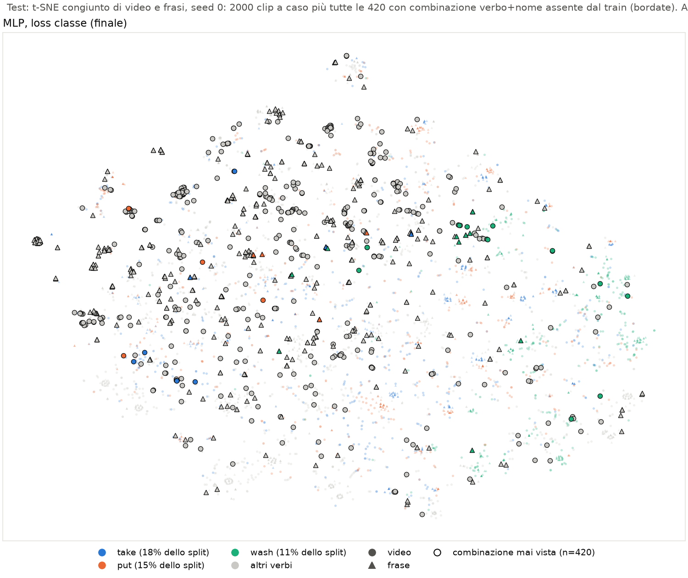

# Ripasso: P7 · t-SNE delle combinazioni mai viste (test)

## Cosa mostra
- **Solo il modello finale**: MLP con loss `classe`, seed 0.
- **Punti nel fit**: le stesse 2000 clip a caso della figura `tsne_spazio_appreso_test.png`,
  più **tutte le 420 clip del test con combinazione verbo+nome assente dal train** (D3, la
  metrica zero-shot principale). 90 delle 420 erano già nel campione a caso, quindi in tutto
  sono 2330 clip, cioè 4660 punti.
- **Clip zero-shot**: marker grandi con **bordo scuro**. Cerchio = video, triangolo = frase.
- **Altre clip**: piccole e sbiadite, fanno da contesto.
- **Colore = verbo** (take, put, wash; grigio = altri verbi), come nella figura dello spazio
  appreso.
- **È un fit a parte.** Aggiungere le 420 clip al campione della prima figura ne avrebbe
  cambiato la composizione: le zero-shot sarebbero passate dal 4% al 18% dei punti. Per questo
  le coordinate non corrispondono a quelle della prima figura.

## Numeri chiave (test, MLP `classe` seed 0)
| Query | esatto R@10 | classe R@10 |
|---|---|---|
| tutte (9668) | 14.37 | 73.99 |
| combinazione mai vista (420) | 11.43 | 15.71 |

Sulle combinazioni nuove classe R@10 crolla da 74% a 16%. La figura serve a vedere dove
finiscono queste clip.

## Come leggerlo
1. **Quasi tutti i punti bordati sono grigi.** Solo 26 delle 420 clip zero-shot hanno verbo
   take, put o wash. I verbi più frequenti tra le zero-shot sono insert (45), mix (40),
   scoop (25), open (19) e remove (15). È naturale: le combinazioni nuove nascono soprattutto con
   verbi meno comuni. Di conseguenza il colore per verbo dice poco su questa figura.
2. **Le clip zero-shot non sono sparse in modo uniforme.** Si concentrano nella parte sinistra e
   centrale della mappa e sono rare a destra, dove sta il contesto di wash e delle classi
   frequenti. Non si "mescolano" con le classi già viste.
3. **Frasi e video zero-shot spesso stanno in gruppi separati.** A sinistra si vedono mucchietti
   di soli triangoli bordati e, altrove, mucchietti di soli cerchi bordati. Una frase nuova che
   non ha vicino i suoi video è una frase per cui il retrieval sbaglia. È coerente con il 16% di
   classe R@10.
4. **I pochi wash zero-shot (verdi bordati) cadono vicino alla zona verde del contesto**, e lo
   stesso vale per alcuni take (blu bordati, in basso a sinistra). Sono pochi casi: è un indizio
   che per questi verbi il modello componga, non una prova.

## Trappole
- **"A occhio" non basta.** Le osservazioni 2 e 3 sono impressioni visive su una proiezione 2D.
  Il numero che conta è nuove classe R@10 (15.71).
- **I verbi più frequenti tra le zero-shot sono grigi.** Questa figura non risponde bene alla
  domanda "una combinazione nuova cade vicino ai video con lo stesso verbo?". Per rispondere
  servirebbe colorare per i verbi più frequenti *tra le zero-shot* (insert, mix, scoop).
- **Mostra solo le combinazioni nuove.** I nomi mai visti (24 clip) e i verbi mai visti (2)
  sono troppo pochi per una figura.
- **Coordinate diverse dalla prima figura**: è un altro fit, quindi le posizioni non si
  confrontano.
